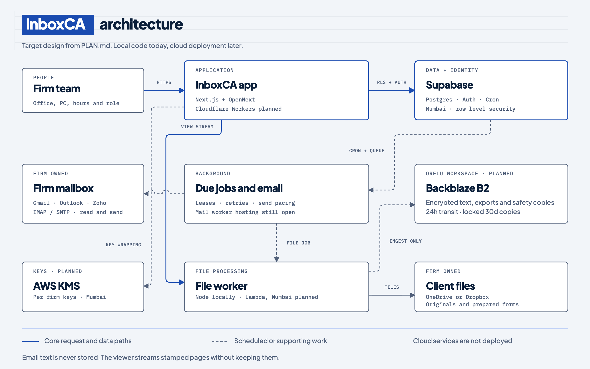

# InboxCA

InboxCA is a product by Orelu for Indian CA firms. This repo contains the public site and the app, built in small steps. Development runs locally; cloud deployment is still pending.

## Architecture



[Open the diagram source](docs/architecture.html). It shows the target design, with planned cloud services labelled. The web app, database, jobs and file worker run locally. Hosting for the mail library remains open.

The file worker receives signed, short lived requests after the app checks access. It receives a drive access token, never a Supabase key. A viewer opening downloads once and streams stamped page images, keeping no pages or cache. Backblaze is for the separate ingest, encrypted records, safety copies and backup paths. Client originals and prepared forms stay in the firm's own drive. Email subjects and bodies are never stored.

Supporting services are kept outside the overview so the main path stays readable:

| Service | Role in the plan |
| --- | --- |
| Amazon SES, Mumbai | System email from Orelu; client replies use the firm's mailbox |
| Web Push | Staff phone notifications |
| Optional AI adapter | Off until the privacy and evaluation gates pass; confirmed records are still required for outputs |
| Sentry server reporter | Error type, code frames and route pattern only; off without configuration |

Cloud accounts, provider registrations and production configuration remain prerequisites. The diagram does not mean those services have been deployed.

## See the app on your laptop

The real app with an invented firm, Demo CA Firm, for anyone who wants to look around or check a change. Every firm, person, client, paper and email in it is made up.

You need Node 22 or newer, Docker (on a Mac, `brew install colima docker`) and `npm ci` once; the Supabase command line comes with it. Then:

```sh
npm run preview              # PORT=3400 npm run preview for another port
```

It starts Docker, the local Supabase and the test mail server when they are stopped, writes the local lines into `.env.local` when they are missing (other lines stay as they are), applies new database changes, makes or refreshes the demo firm, builds when the code changed (`--no-build` uses the last build), starts the app with its file worker and jobs runner on http://127.0.0.1:3300 and opens the sign in page.

Sign in the real way, with two codes:

| Role | Email |
| --- | --- |
| Owner | demo-owner@inboxca.test |
| Partner | nikhil.partner@demo.inboxca.test |
| Manager | priya.manager@demo.inboxca.test |
| Staff | ravi.staff@demo.inboxca.test |
| Front desk | kiran.frontdesk@demo.inboxca.test |

1. The email code lands in the local mail viewer, http://127.0.0.1:54324. Nothing leaves the laptop.
2. The 2 step code: `npm run demo:code` for the owner, `npm run demo:code staff` (or `partner`, `manager`, `front-desk`) for the others. Each key is in `.env.local` as `DEMO_<ROLE>_TOTP`; it is never printed, and you can add it to an authenticator app instead.

Or click the small DEV chip at the bottom of the page, beside the shortcuts hint, and choose a person: it does both steps for you, and the chip shows who you are signed in as. It is for developers only and works only when all six hold, checked on every request; otherwise it is not found:

1. `npm run preview` set `DEV_LOGIN=1` for the server it started (never in a file).
2. It is not a production server, or, as `next start` always says production, check 3 holds.
3. The app uses the local Supabase on this laptop (127.0.0.1 or localhost).
4. The person is one of the five demo people above, in Demo CA Firm.
5. The page was asked for at this laptop's own address (localhost, 127.0.0.1 or [::1]); the app listens only there.
6. Nobody else: no other address, not even a real account on this laptop.

The demo clients send their papers to the firm's mailbox on the test mail server (GreenMail): sales and purchase bills, GST registers, a bank statement, Form 16, Form 26AS, AIS, TIS, TDS and salary registers and challans, all marked as samples. To see them read and filed, sign in as the owner and connect "Test drive on this computer" in Settings. Other emails the app sends go to GreenMail too. If there is no `greenmail` container yet, make it once:

```sh
docker run -d --name greenmail -p 3025:3025 -p 3143:3143 -e GREENMAIL_OPTS="-Dgreenmail.setup.test.smtp -Dgreenmail.setup.test.imap -Dgreenmail.hostname=0.0.0.0 -Dgreenmail.users=office:secret@firm.test -Dgreenmail.users.login=email" greenmail/standalone:2.1.2
```

Ctrl C stops the app, its file worker and jobs runner. Docker keeps running; stop it with `npx supabase stop`, then `colima stop`. Running `npm run preview` again gives the demo firm a fresh copy of its data.

## The product, locally

Local Supabase runs on Docker (on this Mac, through Colima):

```sh
colima start
npx supabase start          # database, sign in and a mail catcher at http://127.0.0.1:54324
npm run db:env              # writes the local connection into .env.local
npm run test:db             # row level security and job tests
npm run build && PORT=3211 npx playwright test tests/e2e/sign-in.spec.ts
```

Sign in is by invitation only: `tests/e2e/sign-in.spec.ts` shows how a person, a firm and their membership are set up before signing in at `/sign-in`. The emailed code arrives in the mail catcher. After a migration, run `npx supabase migration up --local` and `npm run db:types`. Background jobs run when Supabase Cron calls `/api/jobs`; locally nothing calls it until the worker's address and secret are stored in Supabase Vault as `job_worker_url` and `job_worker_secret`.

## File viewer worker

Run `npm run worker` in a separate terminal (Node 22 or newer). Export `FILE_WORKER_SECRET` there and set the same random secret in the app's `.env.local`, with `FILE_WORKER_URL=http://127.0.0.1:3101`. The worker does not read `.env.local` or need database credentials. For the local test drive, give it the same `DRIVE_LOCAL_DIR` as the app. Playwright starts both production servers with a fresh test secret automatically.

Each opening downloads and parses once, then streams stamped page images. Nothing is written or cached by the viewer worker. Limits remain 25 MB, 30 PDF pages, or 1,000 rows and 12 columns of the first sheet. AWS Lambda setup waits for the AWS account. The background document text job remains a Node job outside the web bundle. Pages without text are read by OCR in the file worker (`/ocr`, Tesseract with the bundled English model, so nothing is fetched).

Run `node --experimental-strip-types scripts/viewer-memory.mts` for a fresh worker memory check, or add `--scans` for the invented 30 page scanned PDF. These checks remove their synthetic files when finished.

## Run locally

```sh
npm ci
npm run dev
```

For the production preview:

```sh
npm run lint
npm run typecheck
npm run build
npm run start
```

Next.js App Router, strict TypeScript, Tailwind CSS, shadcn's Base UI dialog, Lucide and Motion for React. Production uses Next's supported Webpack build. The `/` route is prerendered. Cloudflare Workers and OpenNext deployment are future work; nothing has been deployed.

## Files

| Location | Purpose |
| --- | --- |
| `reference/official/` | Official government schemas, templates and notices that the forms library and tests read |
| `reference/CA_Firm_Automation_n8n_workflow.json` | Original workflow reference, not a running integration |
| `app/(site)/page.tsx` | Static page and section order |
| `app/(site)/security/page.tsx`, `content/security.ts` | Security policy page. A lawyer must review it before the site is public |
| `components/site/` | Floating navigation, the clickable demo, the cost calculator, the control cards, the plan finder and the invite dialog |
| `components/ui/dialog.tsx` | Accessible shadcn dialog primitives |
| `content/` | Source based copy and estimated plans |
| `src/lib/submit-invite.ts` | Validation and the single `submitInvite()` connection point |
| `app/fonts/` | Only the self hosted fonts in use, with SIL licences |
| `app/licences.txt/route.ts` | The open source licences page, written at build time from the installed packages and fonts, linked from the footer |
| `public/brand/` | Only assets the page uses |
| `public/brand/tools/` | Other companies' logos for the two rows under the demo, each the owner's own file, unchanged but for size (Gmail, Outlook, OneDrive, Dropbox and Excel from svgl.app; Zoho Mail, Tally, KDK, Winman, SAG Infotech, TaxPower GST, Saral, Electrocom (EasyOFFICE) and ClearTax from their own sites). The filing software row shows only the official files each maker says, on its own pages, that it imports. Check each brand's usage rules before the site is public |
| `docs/architecture.html`, `docs/assets/architecture.png` | Architecture source and README image |
| `tests/` | Unit, database and browser tests |
| `scripts/` | Local setup, the demo firm, page audit and timing, social image, secret scan, key rotation and restore drill |

Every screen on the page is an original illustration with sample data. The page has a hero with a demo that follows one email through the five jobs, the tools it works with, a cost calculator, the control cards, plans, questions and a closing invite.

## Two switches

`SITE_PUBLIC` defaults to `false`, even without an env file. It controls robots metadata, `robots.txt` and structured data. Copy `.env.example` to `.env.local` if needed. Rebuild after changing it. Before public use, confirm the domain and mark, and replace the local `metadataBase` in `app/layout.tsx`.

Set `SHOW_PLANS` to `false` in `content/plans.ts` to hide the section and its navigation link. Every price and plan allowance is in that file. Billing charges from the server's own copy of these figures (the plan formula in the database, which an Orelu admin can change); `tests/db/billing.test.ts` keeps the two equal. The estimator asks for clients, kind of practice and team size, and works out the plan and price in the browser with `src/lib/estimate.ts`, Custom included. The formula values (slab rates, rounding, floor) sit in `content/plans.ts` and must be kept in step with the business plan; a test checks them against its worked examples.

The invite form opens an email draft addressed to `orelu.team@gmail.com`. The visitor must send it. The future endpoint belongs in `submitInvite()`; the page never claims delivery.

## Two optional connections

Both are off until their value is set in `.env.local` (see `.env.example`) and the site is rebuilt.

**Invite requests.** With `NEXT_PUBLIC_INVITE_ENDPOINT` empty, the invite form opens a draft in the visitor's own email app. Set it to a web address that accepts a POST and the form sends the answers there as JSON text (`name`, `firm`, `city`, `email`, `clients`, `sentAt`). The page says "We have your request" only when the address replies with a success code; if it does not, the visitor is offered the email draft. A Google Apps Script web app that adds a row to your own Google Sheet is enough:

```js
function doPost(e) {
  const a = JSON.parse(e.postData.contents);
  SpreadsheetApp.getActiveSheet().appendRow([new Date(), a.name, a.firm, a.city, a.email, a.clients]);
  return ContentService.createTextOutput("ok");
}
```

Deploy it as a web app that runs as you and that anyone can reach, and use its address as the endpoint.

**Visit counting.** With `NEXT_PUBLIC_CF_ANALYTICS_TOKEN` empty, the site counts nothing and calls no other server. Set it to a Cloudflare Web Analytics token and the site loads Cloudflare's counter, which uses no cookies. The privacy and security pages change their wording by themselves when it is on. It counts visits and pages, not clicks on the invite button.

## Policy pages

`/security`, `/privacy`, `/terms`, `/refunds` and `/dpa` share one layout (`components/site/policy.tsx`); their words are in `content/security.ts` and `content/legal.ts`. They are drafts and say that InboxCA is in development. A lawyer must review them before the site is public or takes a payment.

## Browser review

```sh
npm run test:e2e
npm run audit:page
npm run brand:social
```

The audit captures top, control and bottom at 390, 768, 1280 and 1920 pixels, in normal and reduced motion modes. Set `PORT` to run the browser checks beside a server that already uses 3000, for example `PORT=3211 npm run test:e2e`. It checks axe, overflow, console errors and compressed JavaScript. Review exports go to the operating system temporary directory under `inboxca-review`, or the directory set by `AUDIT_OUTPUT`. They are not committed.

Setup references: [Next.js](https://nextjs.org/docs/app/getting-started/installation), [Tailwind](https://tailwindcss.com/docs/installation/framework-guides/nextjs), [shadcn](https://ui.shadcn.com/docs/installation/next), [Motion's small React API](https://motion.dev/docs/react-use-animate), [OpenNext](https://opennext.js.org/cloudflare/get-started).
